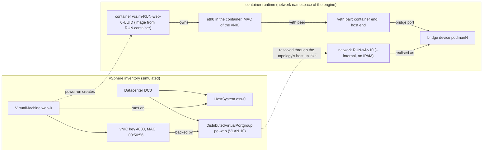
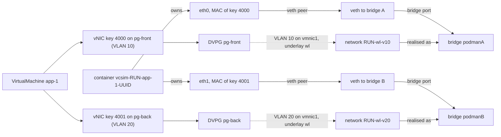
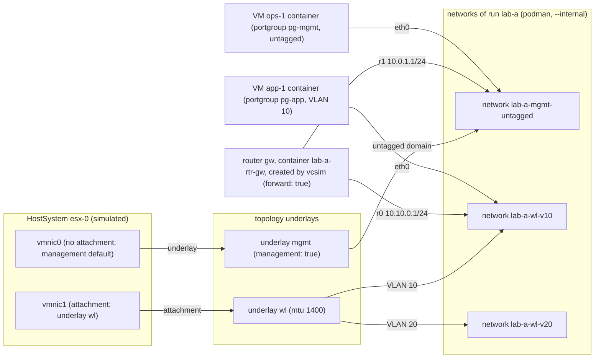
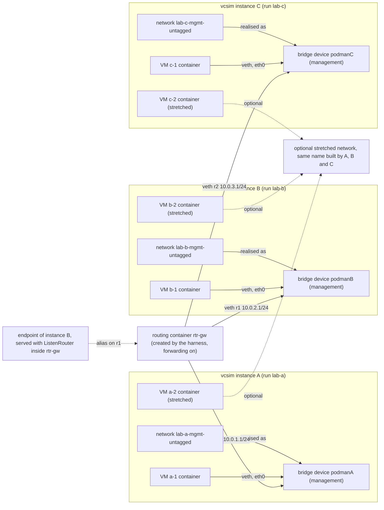

# Container VMs, networking and topologies

vcsim can back a simulated virtual machine with a real container. The VM keeps its
vSphere identity, power state and API surface, and the container runs a real
workload: an OCI image, a process, a network interface. A harness uses this to
run software that expects a Linux guest (a Kubernetes node, a cloud-init
datasource, an agent) against a simulated vCenter. Networking is optional. With a
`-topology` file, each VM network interface joins a container network that
models an L2 segment, and routers can join those segments to each other.

This page covers:

1. How simulated objects map to container runtime objects (diagrams first).
2. The topology file that describes L2 segments, routers and host uplinks.
3. Isolation between several vcsim instances on one host.
4. Reference for the `RUN.*` ExtraConfig keys, lifecycle, the sysctl overlay,
   host prerequisites and troubleshooting.

Timing knobs (latency, jitter, per-method delays) are in
[timing-and-profiles.md](timing-and-profiles.md).

The container runtime is driven through the `docker` CLI, which may be Docker or
podman's docker-compatible front end. Topology networks and routers are driven
through the `podman` CLI directly. Both must be on `PATH`.

## Diagrams

Each domain network is realised by the container runtime as a Linux bridge
device. A container's interface is one end of a veth pair whose other end is a
port of that bridge. The diagrams show that layer. Verified with podman on a
throwaway `--internal` network: netavark creates the bridge (named `podman<N>`)
inside the rootless network namespace when the first container attaches. The
host end of each veth is a port of that bridge, and the container end is renamed
to the `interface_name` given at attach (`eth<i>` or `r<i>`). The bridge is
removed with its network. Under root podman the same objects are in the host
network namespace.

### 1. One vcsim instance, one VM, one network

Without a topology, the container joins the runtime's default network instead,
and no bridge of vcsim's own is involved.



### 2. One VM with two NICs on two portgroups

Each connected vNIC joins the network of its own L2 domain, so each gets its own
bridge and veth pair. Two vNICs on the same domain are refused at power-on,
because a container joins a given network once.



The `eth<i>` names follow the vNIC order (device key), counting every virtual
Ethernet card, including disconnected ones. A disconnected vNIC does not join a
network.

### 3. One instance with a topology: underlays, host uplinks and a vcsim router

This is the same kind of instance as diagram 1, with a topology loaded. The
topology declares two underlays. Host pNICs select an underlay through
`attachments`, and a VLAN is a separate network on its underlay. The router is
declared in the same topology, so vcsim creates it at `Create` and it joins two
domains. Contrast this with diagram 4, where the routing container is created by
the harness and joins networks of several instances.



Each network shown here is a bridge in the runtime, with veth pairs as in
diagram 1. The router's `r<i>` interfaces are veth ends on those bridges. The
router's forwarding is what joins its two domains. Without `forward: true` it
does not bridge them.

### 4. Three vCenters: a management bridge each, a harness-created routing container, and an optional stretched network

Each vcsim instance has its own run label, so its management network and its
bridge are separate from the others. The routing container is created by the
harness, not by vcsim. It is joined to each instance's management network by
name, so it has one interface per management network. vcsim does not create this
container, and a topology cannot name another run's network.

A harness may need more than one such container. For example, a host-side
endpoint that guests must reach on a management network can be served inside the
routing container's namespace with `ListenRouter`, and the harness can dial guests
through the same namespace with `DialRouter`. That endpoint is an address on the
routing container's interface, not a separate container.



Notes on this diagram:

- The stretched network is optional. It exists only if the harness builds it, by
  giving each instance a run and underlay name that produce the same network
  name, as described under "Stretched networks". Its VMs reach each other over
  one bridge, and nothing routes them, so the routing container is not on it.
- A harness may need further routing or gateway containers beyond `rtr-gw`, for
  example one per isolated domain, or one that NATs an endpoint to a host
  address. The same rules apply: a container joins networks by name, and vcsim
  only creates the routers its own topology declares.
- Every VM on a management network needs its gateway set to the routing
  container's address on that network (`10.0.1.1`, `10.0.2.1` or `10.0.3.1`), and
  the address must be configured in the guest, because these networks have no
  IPAM.

## Object mapping

| vSphere or vcsim object | Container runtime object | When it is created | Notes |
| --- | --- | --- | --- |
| VirtualMachine with `RUN.container` | One container, `vcsim-<run>-<vm name>-<VM uid>` | First power-on | Read from the VM's ExtraConfig at that time; see [RUN.* keys](#run-keys). |
| Virtual Ethernet card | Container interface `eth<i>` (or the topology's name for it), with the card's MAC. It is one end of a veth pair whose other end is a port of the network's bridge. | Power-on, and on connect or disconnect while running | `<i>` is the card's index in device-key order. |
| Portgroup (standard or distributed) | The network of an L2 domain (`<run>-<underlay>-v<N>`, or `-untagged`) | When a vNIC on the domain first needs it | The domain is resolved on the VM's host. Same portgroup on another host can resolve elsewhere. |
| L2 domain network | A Linux bridge device (`podman<N>`, in the rootless network namespace under rootless podman), created by netavark at the first attach | First container attached to the network | Removed with the network. The network is `--internal`, so no gateway or NAT is set. |
| NSX-backed opaque network or segment | Network `<run>-seg-<id>` | As above | Independent of any underlay. |
| Host physical NIC (`vmnic<N>`) | Not a container object. It selects an underlay through `attachments`. | n/a | `vmnic0` with no attachment goes to the underlay marked `management`. Any other unmapped pNIC is an error. |
| Underlay (topology) | A set of networks, one per VLAN plus the untagged domain | Lazily, per domain | Carries an MTU, if set, into every network it creates. |
| Router (topology) | Container `<run>-rtr-<name>` from `busybox:latest`, one interface `r<i>` per router interface, each a veth end on that domain's bridge | At `Create`, before any VM starts | Forwarding and routes are set inside its network namespace. |
| Harness-created routing container | A container the harness starts with the container CLI, joined to networks by name, each interface a veth end on that network's bridge | Whenever the harness starts it | vcsim does not create it. See "Joining instances with a routing container". |
| VM with no `RUN.container` | Nothing. The VM stays a pure simulation. | n/a | |
| ESX host | Nothing by default | n/a | An ESX host has no container backing unless the host's advanced option `RUN.container` is set in its template. That path is internal and not covered here. |

Without a topology, the VM's container gets the first vNIC's MAC on the runtime's
default network. Only that first NIC is represented. Additional NICs are not
added to the container. With a topology, every connected vNIC is represented.

### Address assignment

Domain networks are created with `--internal` and `--ipam-driver none`. Two
consequences follow:

- A container on a domain network has no route to the host or the internet
  through that network. Traffic leaves a domain only through a container joined
  to it and to another network, such as a router.
- The runtime does not assign addresses on these networks. A guest needs static
  configuration, or a DHCP service on a harness-supplied container. The simulator
  reports a guest IP only when the runtime reports one, or when the guest reports
  one over GuestRPC (see `RUN.vmci`).

## Topology file

Pass a topology to vcsim with `-topology <file>`, as YAML or JSON. Unknown keys
are rejected, so a misspelt key cannot keep a default silently.

```yaml
run: lab-a                # labels and prefixes every object; at most 32 characters
underlays:
  - name: mgmt
    management: true      # the underlay vmnic0 attaches to when nothing maps it
  - name: wl
    mtu: 1400             # MTU of every network on this underlay
  - name: transit
routers:
  - name: gw
    forward: true         # enable IPv4 forwarding; without it, a router does not bridge
    interfaces:
      - domain: wl/v10    # "<underlay>/v<N>", "<underlay>/untagged" or "seg:<id>"
        address: 10.10.0.1/24
      - domain: transit/untagged
        address: 10.255.0.1/30
        mtu: 1300
    routes:
      - dest: 10.20.0.0/24
        via: 10.255.0.2
attachments:
  - host: "*"             # "*" matches every host; an exact host name wins
    pnic: vmnic1
    underlay: wl
```

| Key | Type | Meaning |
| --- | --- | --- |
| `run` | name | Run label. Prefixes every network and container, and names the run lock. Must match `^[a-zA-Z0-9][a-zA-Z0-9_.-]{0,31}$`. |
| `underlays[].name` | name | An L2 medium. Names are unique. |
| `underlays[].mtu` | 0 or 576..9216 | MTU of the underlay's networks. 0 keeps the podman default. |
| `underlays[].management` | bool | At most one underlay. It takes an unattached `vmnic0`. |
| `routers[].name` | name | Router container name suffix. Unique. |
| `routers[].forward` | bool | Enables IPv4 forwarding in the router. |
| `routers[].interfaces[].domain` | key | `<underlay>/v<N>` (N 1..4094), `<underlay>/untagged`, or `seg:<id>`. The underlay must exist, unless the domain is a segment. |
| `routers[].interfaces[].address` | CIDR | Interface address. |
| `routers[].interfaces[].aliases` | CIDR list | Extra addresses on the same interface and subnet. A guest on that domain reaches the alias by ARP, which is how an endpoint on a domain is served. |
| `routers[].interfaces[].mtu` | 0 or 576..9216 | MTU of this link, overriding the domain's. |
| `routers[].routes[]` | dest, via | Static route in the router's namespace, added with `ip route add`. `via` must be an address on one of the router's domains. vcsim checks only that both parse; the kernel rejects an unreachable `via`, and router start then fails. |
| `attachments[]` | host, pnic, underlay | Cables a host's pNIC to an underlay. A host name is matched exactly, and `*` is the fallback. Each `(host, pnic)` appears once. |

### How a vNIC gets its domain

A vNIC's domain is computed at power-on, and again when the vNIC changes on a
running VM:

1. Its network is read from the inventory. A distributed portgroup gives its VLAN
   and its DVS uplinks. A standard portgroup gives its VLAN and its vSwitch uplinks.
   An NSX-backed network gives a segment id.
2. Each uplink pNIC on the VM's host is looked up in `attachments`. An exact host
   match wins over `*`. `vmnic0` with no attachment uses the management underlay.
3. All of a network's uplinks on that host must land on one underlay, or the
   power-on fails with "uplinks span underlays".
4. The domain is the underlay plus the VLAN (or the untagged domain, or the segment).

Refused cases, each a power-on or configuration error:

- Trunk and PVLAN port configurations are not simulated.
- An uplink not attached to any underlay (other than `vmnic0`, see above).
- Two connected vNICs of one VM on the same domain.
- Uplinks of one network on different underlays.

The topology describes L2 and routing only. It does not add latency, loss or
bandwidth limits to traffic. Partitioning a router is an internal test facility,
not an exported control.

### Routers and endpoints

A router declared in the topology is started by `Model.Create`, and it stays up
until the model is removed. Two harness-level facilities use the router's
namespace:

- `Model.ListenRouter(router, addr)` returns a listener inside a router's
  namespace, so an endpoint on that router's domain (for example an API server a
  guest must reach by its address) is served there.
- `Model.DialRouter(router, addr)` returns a connection from that namespace.

Both return `ErrNoTopology` when the model has no topology.

## Several vcsim instances on one host

Run each instance on its own listen address (`-l`). The isolation rules differ by
whether a topology is loaded.

**Without a topology.** Each model draws a random 12-character run id at first
use. Container names contain it, and every container carries the label
`vcsim.run=<id>`, so one instance never addresses another's container by name.
Instances do not get separate networks: VM containers share the runtime's default
network, and a named network in `RUN.network` is shared by name. Two instances
can therefore reach each other's containers over the default network.

**With a topology.**

- The `run` value prefixes every network (`<run>-<underlay>-v<N>`, `<run>-seg-<id>`),
  every router (`<run>-rtr-<name>`) and every VM container. Instances with
  different `run` values share no networks unless a harness makes them do so.
- A run lock is held for the life of the model. It is an exclusive `flock` on
  `$XDG_RUNTIME_DIR/vcsim/<run>.lock`, or on a per-user directory under the temp
  directory when `XDG_RUNTIME_DIR` is unset. A second live instance that asks for
  the same `run` fails with "run is held by a live vcsim instance".
- A new instance sweeps podman containers and networks labelled with runs whose
  lock it can take, so objects of killed processes are removed. Objects of a run
  whose lock is held are left alone. PIDs are not consulted.
- SIGINT and SIGTERM remove the model's containers and networks before exit. A
  SIGKILL leaves them behind until a later instance sweeps them.

## Joining instances with a routing container

A topology router can join only the networks of its own run. Another instance's
networks carry that instance's run prefix, and each run is locked by its own
process. So a router that must connect several instances is created outside
vcsim's topology. There are two patterns.

**Harness-created router.** The harness runs a container with podman, joins it to
each instance's network by name, and enables forwarding. Each network carries the
label `vcsim.run=<run>`, and its name is `<run>-<underlay>-untagged` or
`<run>-<underlay>-v<N>`, so the harness can find it by label or by name. This is
the pattern in the diagram above. Guests on each management network use the
router's address on that network as their gateway.

```sh
# Illustrative only: the network names come from the instances' topologies.
# Podman joins one network per --network flag; interface_name is the router's own name for it.
podman run -d --pull=never --name rtr-gw --cap-add NET_ADMIN \
  --sysctl net.ipv4.ip_forward=1 \
  --network lab-a-mgmt-untagged:interface_name=r0 \
  --network lab-b-mgmt-untagged:interface_name=r1 \
  --network lab-c-mgmt-untagged:interface_name=r2 \
  busybox sleep infinity
podman exec rtr-gw ip addr add 10.0.1.1/24 dev r0
podman exec rtr-gw ip addr add 10.0.2.1/24 dev r1
podman exec rtr-gw ip addr add 10.0.3.1/24 dev r2
```

The topology's own routers do the same work inside vcsim, with the host's `ip`
and `sysctl` run in the router's namespace.

**Served endpoint.** An instance whose endpoint must be reachable from another
instance's domain serves it inside that domain's router namespace with
`ListenRouter`, and the harness dials guests through `DialRouter`. This needs the
router in the topology of the instance that owns the domain.

### Stretched networks

A stretched L2 means that two instances' hosts share one management network, so
an address can move between their VMs. vcsim has no API to join a network owned
by another run. The only way to share one is for the second instance's topology
to name its run and underlay so that the network name it computes is the same as
the first instance's. That relies on the naming rule above, and it breaks if the
rule changes. Treat it as a workaround. A first-class "join existing network"
option would be the supported form.

## RUN.* keys

Set these as ExtraConfig options on the VM. Keys are read at power-on, when the
container is created. A later change takes effect only after the container is
removed (see "Lifecycle"). Boolean values are JSON, `true` or `false`. A value
that does not parse as a boolean leaves the default in place without an error.

| Key | Value | Effect | Default | Constraints |
| --- | --- | --- | --- | --- |
| `RUN.container` | An image name, or a JSON array `["image", "arg", ...]` | Backs the VM with a container. `["alpine", "sleep", "infinity"]` runs `sleep infinity`. | Absent: no container. | A JSON array is passed as literal words. Any other value is a raw string of `docker create` arguments ending in the image, which bash splits. That is a legacy form and is not quoted. A JSON string such as `"nginx"` is not a JSON array, so it takes the raw form. |
| `RUN.mountdmi` | bool | Mounts the VM's DMI data at `/sys/class/dmi/id`. | `true` | Set `false` where that mount is refused, as under rootless podman. |
| `RUN.machineId` | bool | Mounts the VM's BIOS UUID, as 32 lowercase hex digits, read-only at `/etc/machine-id` and `/var/lib/dbus/machine-id`. | `true` | Not mounted where a `RUN.volume` already targets that path. Gives each VM a distinct machine id, even without DMI. |
| `RUN.network` | Network name | Joins the container to the named network, in addition to the NIC networks. Repeatable. | None | `host` is refused with `RUN.sysctl`. |
| `RUN.privileged` | bool | Adds `--privileged`. | `false` | Needed by an image that runs systemd as PID 1. |
| `RUN.nestedContainers` | bool | Lets the container run containers, such as a Kubernetes node. Adds `--privileged`, `--cgroupns=private`, unconfined seccomp and AppArmor, `tmpfs` at `/tmp` and `/run`, the `RUN.nestedVolumes` volumes, `/lib/modules` read-only, and `/dev/fuse`. | `false` (the container uses `--cgroupns=host`) | The flags are adapted from kind. |
| `RUN.nestedVolumes` | JSON array of absolute container paths | With `RUN.nestedContainers`, mounts each path as an anonymous volume. | `["/var"]` | Paths must be absolute and clean, with no `:`, and not `/`. An empty array mounts none. A value that does not parse is logged and ignored. A volume over a large path copies that content at every container creation. |
| `RUN.vmci` | bool | Serves GuestRPC to the guest over a Unix socket at `/run/vmware/rpc.sock`, names it in `$VMX_RPC_SOCK`, and mounts the govmomi toolbox at `/usr/bin/vmware-rpctool` unless a `RUN.volume` targets that path. The guest can read `guestinfo.*` and write keys without `/`. | `false` | On Linux the toolbox is built with `go build` on first use, which needs a Go toolchain and the govmomi source. If the build fails, the socket is still served and the binary is not mounted. |
| `RUN.sysctl` | `emulate=<key>,<key>,...` | See "Sysctl overlay". | Absent | Power-on fails on an invalid value. |
| `RUN.port.<containerPort>` | Host port | Publishes the container port on the host port (`-p host:container`). | None | The container port is the last dot-separated part of the key. |
| `RUN.volume.<label>` | `source:destination[:options]` | Adds a mount, as `docker run -v`. A named volume is created and labelled, and removed with the container. | None | `source` is a host path (starts with `/`) or a volume name. Empty values are ignored. |
| `RUN.env.<NAME>` | Value | Sets environment variable `NAME`. | None | The name is the last dot-separated part of the key, so `RUN.env.A.B` sets `B`. Use names without dots. |
| `guestinfo.<key>` | Value | Sets `VMX_GUESTINFO_<KEY>` (upper case, dots as underscores) and `VMX_GUESTINFO=true`. | None | Lets cloud-init's VMware datasource read guestinfo in a container. |

### NIC mapping

No `RUN.*` key sets a NIC. The mapping comes from the VM's virtual NICs and from
`-topology`. With a topology, each connected vNIC joins its domain with
`--network <net>:mac=<MAC>,interface_name=eth<i>`. Without one, only the first
vNIC's MAC is applied, on the default network. Under rootless podman with no
`RUN.network`, that MAC is applied only when pasta is installed and the VM has one
NIC. Otherwise the MAC is not applied, and a message is logged.

## Lifecycle

| VM operation | Container effect |
| --- | --- |
| Power on, first time | Container created (any container of the same name is removed first), started, and watched. vcsim then polls the container for an IP up to 5 times, 500 ms apart, and stops polling once one is reported. The VM powers on whether or not an IP appears. |
| Power on, after power off | The existing container is started again. Its configuration does not change. |
| Power off, shut down guest | `docker stop`. Tools are reported as not running. |
| Suspend, standby | `docker pause`. |
| Reset | `docker restart`. |
| Change the VM's vNICs while running (topology loaded) | The container's interface is disconnected and connected again, with the same MAC. Guests find the interface by MAC. |
| Remove `RUN.container` from ExtraConfig | The container is removed, and the VM becomes a pure simulation. |
| Destroy | `docker rm -v -f`. Labelled volumes and networks of the container are removed. The machine-id file, the sysctl overlay directory and the GuestRPC directory are removed. |
| Container removed outside vcsim | vcsim destroys the VM, because its backing is gone. |
| Model shut down (SIGINT or SIGTERM) | Containers are removed, then the underlay's routers and networks. |

A harness that restarts a container VM with changed `RUN.*` keys must remove the
container first (destroy the VM, or remove `RUN.container`), or the old
configuration is kept.

## Sysctl overlay

Host-global sysctls, such as `net.ipv4.tcp_mem`, are not namespaced, so a
container cannot write them. A guest that does (for example a tuning agent) then
fails. `RUN.sysctl` lets such writes succeed inside the container, without
reaching the host.

```text
RUN.sysctl = emulate=net.ipv4.tcp_mem,net.core.somaxconn
```

- Each listed key is seeded with the host's value at power-on. Writes to it land
  in an overlay file and read back, and the host is not changed.
- Keys must match `^[a-z0-9_-]+(\.[a-z0-9_-]+)*$`. The list may be empty
  (`emulate=`), which unmasks `/proc/sys` and emulates nothing.
- Namespaced keys, such as `net.ipv4.conf.all.arp_ignore`, take real writes in
  the container's own network namespace. Other host-global keys that are not
  emulated fail as the kernel fails them.
- The container's `/proc/sys` is unmasked, and `NET_ADMIN` is added, which the
  kernel needs for namespaced `net.*` writes. `SYS_ADMIN` is added for the overlay
  mounts. The overlay drops `SYS_ADMIN` before the image's entrypoint runs, unless
  the container is privileged or runs nested containers.
- The image's entrypoint is replaced by an overlay script, which mounts the
  values and then runs the image's own entrypoint and command.
- Requirements, each checked at power-on before host resources are created:
  - `RUN.container` must be a JSON array.
  - The image must be present locally, because its entrypoint is read with
    `docker image inspect`.
  - `RUN.network` must not be `host`. Otherwise the container would share the
    host's network namespace, where the unmasked `/proc/sys` would write the
    host's namespaced keys.

Every emulated key is reported as `SysctlEmulatedNotApplied` ("emulated, not
applied"). Its value is never reported as an effect on the host. The Go API
`VirtualMachine.EmulatedSysctls` returns, for each key, the seed, the value the
running container reads back, and that status.

## Host prerequisites

These are the requirements the code checks or depends on.

- `docker` CLI on `PATH`. Container operations run `docker`. A `docker` symlink
  to podman works.
- `podman` on `PATH` when a topology is used. Networks and routers are created
  with `podman network create`, `podman run`, `podman container exists` and
  `podman unshare nsenter`.
- `bash` on `PATH`, for creating containers. Without it, vcsim falls back to
  `/bin/sh`.
- The `ip` and `sysctl` binaries on the host. Router configuration runs them
  inside the router's namespace with `podman unshare nsenter`.
- The image `busybox:latest`, present locally. Routers are started with
  `--pull=never`.
- Images for `RUN.container` and `RUN.sysctl` present locally, or pulled by the
  engine on first use.
- Rootless podman is supported. vcsim detects it with `docker info`. Without
  pasta, a rootless container's primary interface cannot take a MAC, and vcsim
  logs that.
- `/dev/fuse` on the host, for `RUN.nestedContainers`. Nested containers also
  need cgroup v2 delegation from the host. vcsim does not check for it.
- A Go toolchain and the govmomi source tree, for `RUN.vmci` on Linux.
- Readable `/proc/sys` on the host, for sysctl seeding.

vcsim does not check kernel sysctl limits or the user namespace setup for rootless
podman. Those are outside this page.

## Troubleshooting

| Symptom | Likely cause |
| --- | --- |
| "run ... is held by a live vcsim instance" | Another live process uses the same `run` in its topology. Pick a different `run`. |
| "pnic ... not attached to an underlay" | The host's uplink pNIC has no `attachments` entry, and is not `vmnic0`. Add an attachment. |
| "uplinks span underlays" | One network's uplinks on one host are attached to different underlays. |
| "vlan mode not simulated" | The portgroup is trunk or PVLAN. |
| "nics N and M both join ..." | Two connected vNICs of one VM map to the same domain. |
| "RUN.sysctl needs a private network namespace" | `RUN.network` is `host`. |
| "RUN.sysctl: RUN.container must be a JSON array" | `RUN.container` was given in the raw form. Use the JSON array form. |
| Container VM has no IP in `guest.net` | The domain network has no IPAM, so the runtime assigns no address. Configure the guest statically, or report the address over GuestRPC with `RUN.vmci`. |
| Guest cannot reach a router | The router's `forward` is `false`, or the guest's gateway is not the router's address on that domain. |
| "vmware-rpctool not mounted" in the log | The toolbox build failed. Check that `go` is on `PATH` and the govmomi source is present. |
| Router "container ... exists but was not started by this run" | A container of that name exists without vcsim's labels. Remove it, then start the model again. |
| Topology appears to be ignored | See "Known gaps": `-esx` and `-load` do not load the topology. |

## Known gaps

These behaviours were read from the code. They are recorded here, not worked
around in this page.

- `-esx` builds a new model and copies a few options (datastores, VMs, autostart,
  delays), not the topology. A topology given with `-topology` is dropped
  without an error.
- `-load` restores a saved model through `Model.Load`, which does not realise the
  topology (only `Model.Create` does). Read from the code; not exercised. The
  topology is silently ignored with `-load`.
- Without a topology, VM containers from different instances share the runtime's
  default network, so they can reach each other.
- The `vcsim-underlay` bridge used by the host backing path has no run prefix,
  and an existing bridge of that name is reused. No vcsim flag sets up host
  backing.
- A topology cannot name a network of another run. Joining instances relies on
  the naming rule described under "Stretched networks".
- Topology traffic has no latency, loss or bandwidth model.
